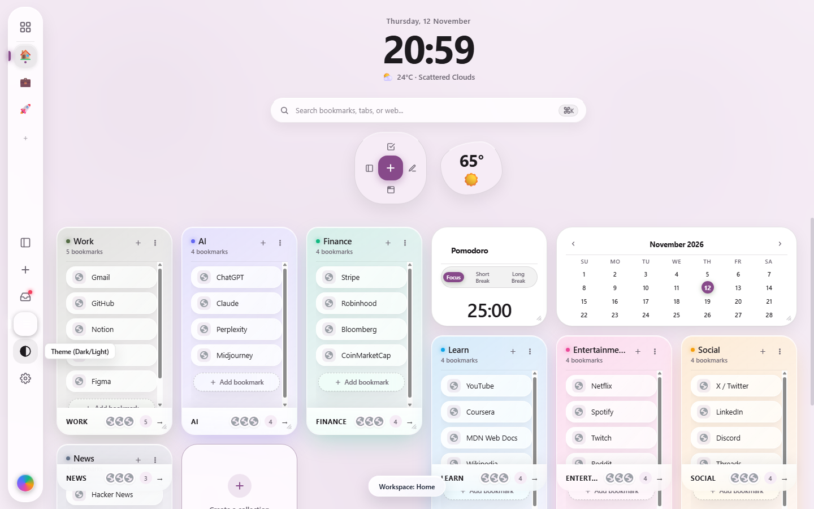

# Minimal Board Tab 🌸

<p align="center">
  
  
  
  
  
</p>

<p align="center">
  <strong>Keyboard-first visual bookmark & tab manager. Fast, calm, local-first.</strong><br>
  Designed for modern Chromium browsers (Chrome, Brave, Edge, Arc) to replace noisy new tab pages with a serene workspace inspired by Google Material You organic widgets and calm hero typography.
</p>

---

<p align="center">
  
</p>

---

## ✨ Features at a Glance

### 🌅 Serene Hero Atmosphere
- **Display Clock (`68px`)**: Bold tabular display time updated live every second (`font-variant-numeric: tabular-nums`).
- **Contextual Date & Weather Subtitle**: Localized calendar date (`Weekday, D Month`) and real-time live weather chip (`24°C · Scattered Clouds`).
- **Tranquil Sunset Gradient Mesh**: Soft multi-stop radial atmosphere blending serene pastel sky-blue, gentle lilac, peach, and golden sunset tones, seamlessly paired with a deep twilight indigo-violet dark theme.

### 🍀 Google Material You Organic Widgets
- **4-Leaf Clover Quick-Capture Cluster**:
  - `+` **Center Button**: One-click Quick Add Link modal with real-time URL validation and auto-favicon fetching.
  - 📋 **Top Leaf (Task)**: Quick-capture task note directly to your active column.
  - 📝 **Right Leaf (Note)**: Rich Markdown note editor modal.
  - 🪟 **Bottom Leaf (Window)**: One-click session snapshot — packages all open tabs into a timestamped session column.
  - 📑 **Left Leaf (Drawer)**: Toggles the collapsible open-tabs side drawer.
- **Asymmetric Pebble Weather Widget**:
  - Tactile, organically contoured pebble shape with large tabular temperature display and condition icon.
  - Click to change city / refresh weather instantly.

### 📐 Consolidated 2-Nav Architecture
- **62px Left Side Rail**:
  - Dedicated vertical workspace switcher tabs.
  - Primary action triggers for new column creation, tab history, and settings modal.
  - Free from clutter: zero redundant floating action buttons (FABs), zero bottom docks, and zero distracting top-right toolbars.
- **Centered Top Search Pill (`⌘K` / `Ctrl+K`)**:
  - Instant fuzzy search across all bookmarks, notes, and tags.
  - Real-time card filtering with escape/clear button shortcuts.

### 🗃️ Material You Squircle Bento Columns & Cards
- **Harmonized Geometric Radius Hierarchy**:
  - `--r-tile: 28px`: Outer bento columns and clover cluster.
  - `--r-inner: 16px`: Bookmark cards, squircle badges, and center action buttons.
  - `--r-pill: 999px`: Search bar, rail icon controls, and leaf buttons.
- **Micro-Interactions**: Gentle `-2px` hover elevations with tinted ambient drop shadows.

---

## ⌨️ Keyboard Shortcuts Matrix

Minimal Board Tab is built keyboard-first so you can navigate and organize without ever reaching for the mouse:

| Shortcut | Action | Description |
| :--- | :--- | :--- |
| <kbd>⌘K</kbd> or <kbd>Ctrl+K</kbd> | **Focus Search** | Highlights the centered search pill instantly |
| <kbd>/</kbd> | **Quick Search** | Focus search input when not typing in a text field |
| <kbd>Esc</kbd> | **Clear / Dismiss** | Clears active search filter or dismisses open modals |
| <kbd>C</kbd> | **New Column** | Prompts to create a new board column |
| <kbd>D</kbd> | **Toggle Drawer** | Toggles the open tabs side drawer |
| <kbd>T</kbd> | **Cycle Theme** | Cycles between Light, Dark, and System color schemes |
| <kbd>V</kbd> | **Cycle View** | Switches between Comfortable, Compact, and Minimalist card density |
| <kbd>Shift+N</kbd> | **New Note** | Opens the rich markdown note modal |
| <kbd>⌘Z</kbd> or <kbd>Ctrl+Z</kbd> | **Undo Action** | Restores the most recently deleted card or column |

---

## 🚀 Installation Guide

### Loading as an Unpacked Extension in Chromium

1. **Clone the repository**:
   ```bash
   git clone https://github.com/adhityamac/arc-organiser.git
   cd arc-organiser
   ```

2. **Open Extensions Manager** in your browser:
   - **Google Chrome**: navigate to `chrome://extensions`
   - **Brave Browser**: navigate to `brave://extensions`
   - **Microsoft Edge**: navigate to `edge://extensions`

3. **Enable Developer Mode**:
   - Toggle the **Developer mode** switch in the top-right corner.

4. **Load the Extension**:
   - Click **Load unpacked** in the top-left toolbar.
   - Select the cloned `arc-organiser` project folder.

5. **Open a New Tab**:
   - Press <kbd>Ctrl+T</kbd> (or <kbd>⌘T</kbd>) to experience your new calm, Material You new tab workspace!

---

## 🛠️ Development & Testing

Built with pure, modern web standards: **zero external runtime dependencies**, **Manifest V3**, and native ES modules.

### Prerequisites
- Node.js (v18.0.0 or later recommended)

### Running the Test Suite
The codebase includes a comprehensive 53-test suite covering URL sanitization, search scoring, data migrations, cryptographic backups, and strict performance budgets:

```bash
node --test tests/url.test.mjs tests/store.test.mjs tests/markdown.test.mjs tests/search.test.mjs tests/merge.test.mjs tests/rules.test.mjs tests/crypto.test.mjs tests/benchmark.test.mjs
```

### Performance Budgets (Section 5.6 Verified)
- ⚡ **10,000 Cards Search Latency**: `< 16 ms` (Benchmarked at ~12.3 ms)
- ⚡ **10,000 URLs Canonical Normalization**: `< 200 ms` (Benchmarked at ~41.9 ms)
- ⚡ **10,000 Cards Rule Evaluation**: `< 100 ms` (Benchmarked at ~6.5 ms)

### End-to-End Browser Testing
Automated browser and DevTools console verification using Playwright:

```bash
# Run the live browser verification script
node scripts/browser-test.mjs
```

---

## 🔒 Privacy & Architecture

- **100% Offline & Local-First**: All bookmarks, notes, workspaces, and columns are saved directly in `chrome.storage.local`.
- **Zero Third-Party Trackers**: No telemetry, no analytics beacons, and no external tracking scripts.
- **Safe Markdown & Defanged Links**: Built-in HTML sanitization and defanging against `javascript:` injection and XSS exploits.
- **Encrypted Export & Import**: Client-side AES-GCM encryption with Argon2/PBKDF2 key derivation for secure multi-device backups.

---

## 📄 License

Distributed under the [MIT License](LICENSE). Built with ❤️ for productive and calm browsing.
